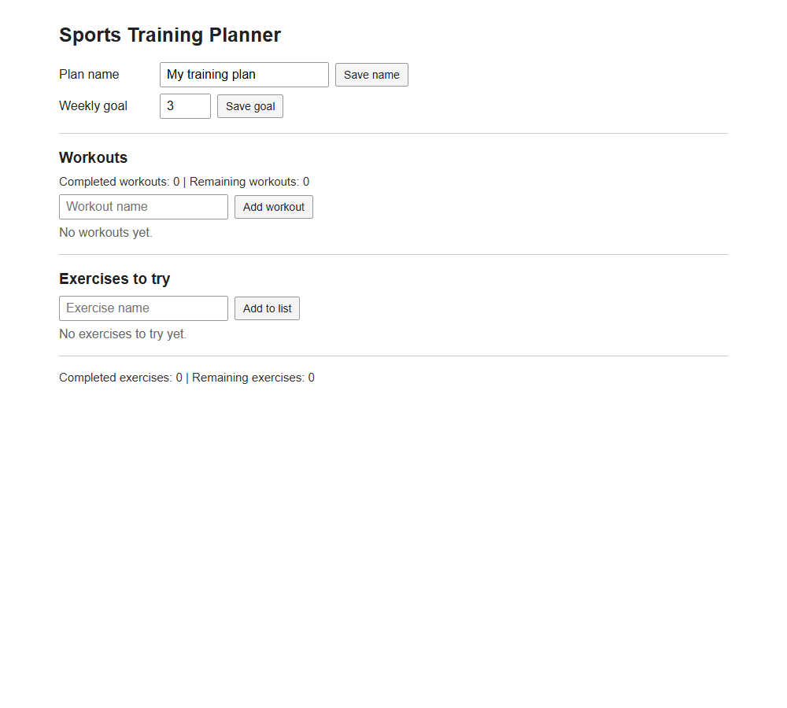
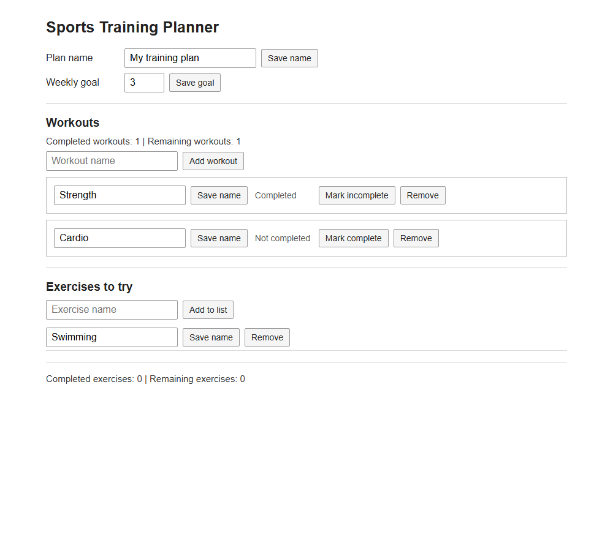
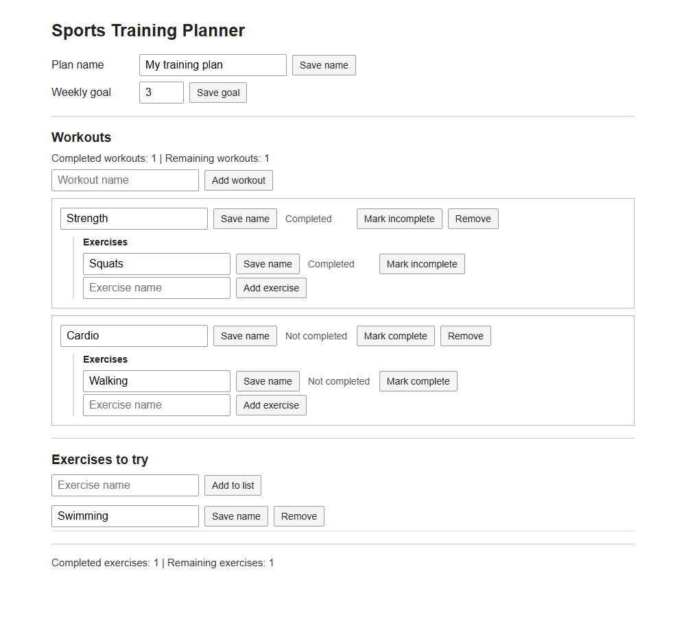

# Exercise: Sports Training Planner

## What are we building?

Imagine you want to plan your workouts. You want to give your training plan a name, set a weekly workout goal, and keep a list of workouts. For each workout, you want to list its exercises and mark them as completed when you finish them.

You also want a separate list of exercises to try later. These items are ideas; they are not part of a workout.

Build an app that lets a user do these things and see how many workouts and exercises are completed or still remaining. The app does not need dates, a calendar, or automatic weekly resets. The weekly goal is a number the user can change.

## The data model

Create a `models` folder under `src/app` and copy these interfaces into `src/app/models/training.model.ts`:

```ts
export interface TrainingPlan {
  readonly name: string;
  readonly weeklyGoal: number;
  readonly workouts: readonly Workout[];
  readonly tryItems: readonly TryItem[];
}

export interface Workout {
  readonly id: string;
  readonly name: string;
  readonly completed: boolean;
  readonly exercises: readonly TrainingExercise[];
}

export interface TrainingExercise {
  readonly id: string;
  readonly name: string;
  readonly completed: boolean;
}

export interface TryItem {
  readonly id: string;
  readonly name: string;
}
```

The plan contains workouts and items to try. Each workout contains its own exercises. Each item has an ID, so the app can find it even if its name changes. The properties and arrays are `readonly`: create new values instead of changing them directly.

A workout's completed status is separate from the status of its exercises. Changing one does not automatically change the other.

## The screen

Show the plan name and goal at the top. Under them, show the workouts and the exercises inside each workout. Show the separate **Exercises to try** list below. Also show the number of completed and remaining workouts and exercises.

The user can enter a name or goal and click a button to save it. They can add, rename, and remove workouts and items to try. For each workout, they can add and rename exercises. They can also change the completed status of a workout or an exercise.

### Example screens

At the start, there are no workouts or exercises:



After adding workouts and an item to try:



After adding exercises to workouts and marking some as completed:



These pictures show the app at different stages of the exercise. The example names and numbers are not required.

## The view model

The component's view model contains the state and actions that the screen needs.

### Core state

Store one `TrainingPlan` in a signal named `plan`. It contains the name, goal, workouts, exercises inside workouts, and items to try. Start with the name `My training plan`, a goal of `3`, and empty lists.

### Derived state

Calculate these values from `plan` using `computed` signals and pure functions:

| Value | What to count |
| --- | --- |
| Completed workouts | Workouts with `completed: true` |
| Remaining workouts | Workouts with `completed: false` |
| Completed exercises | Exercises with `completed: true`, across all workouts |
| Remaining exercises | Exercises with `completed: false`, across all workouts |

These are counts of the items currently in the plan. Do not store separate counts or use an effect to update them.

### Actions

The component needs actions for the following user choices:

| Part of the plan | Actions |
| --- | --- |
| Plan | Change the name and change the weekly goal |
| Workouts | Add, rename, remove, and change the completed status |
| Exercises to try | Add, rename, and remove |
| Exercises in a workout | Add, rename, and change the completed status |

Use the item IDs to choose which item to change. Removing a workout also removes the exercises inside it.

## Before you start

Create a new Angular application and run it:

```powershell
ng new sports-training-planner
cd sports-training-planner
ng serve
```

Open `http://localhost:4200`. Use the generated standalone root component. You do not need routing, a server, a CSS library, or extra components. Remove the starter content from the template.

Copy the data model above into your project. Work through the steps in order and check each step in the browser. At first, write update code in the component. Later, move it into pure functions and reusable helpers. Use simple HTML inputs, buttons, and lists; you do not need to copy the colors or layout in the pictures.

## Step 1 - Create the plan signal

Import `signal` from `@angular/core` and `TrainingPlan` from your model file. Start with an empty plan:

```ts
readonly plan = signal<TrainingPlan>({
  name: 'My training plan',
  weeklyGoal: 3,
  workouts: [],
  tryItems: [],
});
```

Show the name and goal on the screen. Add an input and a button for changing each value. The lists are empty for now; you will add controls for them in the next steps.

Accept non-empty names and whole-number goals of `0` or more. If an input is invalid, show a short message and do not change the plan.

### Change the name

Do not change `plan.name` directly. Create a new object with spread:

```ts
this.plan.update(plan => ({ ...plan, name: newName }));
```

The new object has the new name and keeps the old goal. The old object is not changed.

### Change the goal

On your own, update the goal in the same way. Keep the current name.

**Checkpoint:** Change the name and then the goal. Both new values should appear. Changing one must not reset the other.

## Step 2 - Add workouts and exercises to try

The plan already has two empty arrays. Add a list and an input with an **Add** button for each kind of item. Create each workout with `completed: false` and an empty `exercises` array. The exercises will be used in step 7.

Give each new item an ID that does not change when the name changes. You can create it with `crypto.randomUUID()` in the component action, before calling `.update()`. Do not use the name or array index as the ID. Reject empty names with a short message.

### Add a workout

Create the `workout` object first. Then return a new plan with a new array:

```ts
this.plan.update(plan => ({
  ...plan,
  workouts: [...plan.workouts, workout],
}));
```

The spread on `plan` copies the plan. The spread on `plan.workouts` makes a new array.

### Add an exercise to try

On your own, add a new `TryItem` to `tryItems`. Keep the other plan properties unchanged.

**Checkpoint:** Add two workouts and two items to try. All four items should remain visible. Save a reference to the old plan and its arrays before an update; check that they still have their old values after the update.

## Step 3 - Change and remove items

Add controls to rename and remove both workouts and items to try. Also add a button or checkbox to change a workout between completed and not completed. Use IDs to choose items.

### Change a workout

Use `map` to make a new array. Return a new object for the matching workout and keep the other objects:

```ts
this.plan.update(plan => ({
  ...plan,
  workouts: plan.workouts.map(workout =>
    workout.id === workoutId
      ? { ...workout, completed: !workout.completed }
      : workout
  ),
}));
```

On your own, rename a workout by ID and rename an item to try by ID. Reject empty names.

### Remove a workout

Use `filter` to keep every workout except the selected one:

```ts
this.plan.update(plan => ({
  ...plan,
  workouts: plan.workouts.filter(workout => workout.id !== workoutId),
}));
```

On your own, remove an item to try by ID.

**Checkpoint:** Rename, complete, and remove items. Other items must not change. Check that the old arrays and the old version of a changed item still have their old values.

## Step 4 - Move updates into functions

Create a type for a function that receives state and returns new state:

```ts
export type Updater<T> = (state: T) => T;
```

Place the type and your update functions in separate files outside the component. The component still owns the signal and handles user input.

### Create an updater

An **updater factory** takes the action's input and returns an updater. For example:

```ts
export function toggleWorkout(workoutId: string): Updater<TrainingPlan> {
  return plan => ({
    ...plan,
    workouts: plan.workouts.map(workout =>
      workout.id === workoutId
        ? { ...workout, completed: !workout.completed }
        : workout
    ),
  });
}
```

The component can now call:

```ts
this.plan.update(toggleWorkout(workoutId));
```

The updater does not read the component or change its input. It returns a new plan.

### Create more updaters

On your own, create updater factories for renaming a workout and removing an item to try. Use them from the component. Then move the other actions from steps 1-3 into updater factories too.

Keep ID creation and input validation in the component actions. Pass the new item or value to the updater; do not generate IDs inside an updater.

**Checkpoint:** The app should work as before. The component actions should pass updaters to `.update()` rather than contain the update logic.

## Step 5 - Make generic helpers

Some updaters repeat the same array logic. Create a separate file for reusable functions. Each helper must return a new array and must not change its input. Use `readonly T[]` for the input so the helpers can accept the arrays in your model.

### Add an item

Create a generic helper:

```ts
export function addItem<T>(items: readonly T[], item: T): T[] {
  return [...items, item];
}
```

Use it in the updater that adds a workout.

On your own, use the same helper in the updater that adds an item to try.

### Remove an item

Create a generic `removeItemIf` helper. It receives an array and a predicate. Use `filter` to keep items for which the predicate is false:

```ts
export function removeItemIf<T>(
  items: readonly T[],
  matches: (item: T) => boolean,
): T[] {
  return items.filter(item => !matches(item));
}
```

For example, `removeItemIf([1, 2, 3], n => n === 2)` returns `[1, 3]`.

Use it in the updater that removes a workout. On your own, use it in the updater that removes an item to try.

### Change an item

Create a generic `changeItemIf` helper. It receives an array, a predicate, and a function that returns changes to one item:

```ts
export function changeItemIf<T>(
  items: readonly T[],
  matches: (item: T) => boolean,
  changes: (item: T) => Partial<T>,
): T[] {
  return items.map(item =>
    matches(item) ? { ...item, ...changes(item) } : item
  );
}
```

Use it in the updater that toggles a workout.

On your own, use it in the updaters that rename a workout and an item to try.

**Checkpoint:** Add, change, and remove both kinds of items. Confirm that the old arrays are unchanged and that an item with a different ID is not changed.

## Step 6 - Calculate values from the plan

The plan name, goal, workouts, and items to try are **core state**: the app stores them. The number of completed workouts can be calculated from the workouts, so it is **derived state**. Do not store a separate count or use an effect to keep it up to date.

Create a separate file for pure calculation functions. These functions receive data and return a result; they do not read signals or change their inputs.

### Count completed workouts

Create a pure function:

```ts
export function countCompletedWorkouts(workouts: readonly Workout[]): number {
  return workouts.filter(workout => workout.completed).length;
}
```

In the component, call it from a `computed`:

```ts
readonly completedWorkouts = computed(() =>
  countCompletedWorkouts(this.plan().workouts)
);
```

Display the result.

### Count remaining workouts

On your own, write a pure function that counts workouts whose `completed` value is `false`. Call it from another `computed` and display it.

**Checkpoint:** With two workouts, mark one as completed. The counts should be completed `1` and remaining `1`. Remove the completed workout: the counts should become `0` and `1`. With no workouts, both counts should be `0`.

## Step 7 - Add exercises inside workouts

Each workout already has an empty `exercises` array. Under each workout, show its exercises. Add an input and button to add an exercise to that workout, and controls to rename and complete an exercise. New exercises start as not completed. Reject empty exercise names with a short message.

Install Immer in your project:

```powershell
npm install immer
```

`produce` receives the old state and gives you a **draft**. You can change the draft; Immer creates the next state without changing the old one.

### Add an exercise

Create the exercise and its ID in the component action. Pass it and the workout ID to this updater:

```ts
import { produce } from 'immer';

export function addExercise(
  workoutId: string,
  exercise: TrainingExercise,
): Updater<TrainingPlan> {
  return plan => produce(plan, draft => {
    const workout = draft.workouts.find(item => item.id === workoutId);
    if (workout) {
      workout.exercises.push(exercise);
    }
  });
}
```

Call it with `this.plan.update(addExercise(workoutId, exercise))`.
If the workout does not exist, the plan stays unchanged.

### Change exercises

Create an Immer-based updater that toggles an exercise's completed status. Find the workout by ID, then find the exercise by ID inside it. If either is missing, leave the plan unchanged:

```ts
export function toggleExercise(
  workoutId: string,
  exerciseId: string,
): Updater<TrainingPlan> {
  return plan => produce(plan, draft => {
    const workout = draft.workouts.find(item => item.id === workoutId);
    const exercise = workout?.exercises.find(item => item.id === exerciseId);
    if (exercise) {
      exercise.completed = !exercise.completed;
    }
  });
}
```

On your own, create another Immer-based updater to rename an exercise. Reject an empty name in the component before calling it. Again, leave the plan unchanged if either ID is missing.

**Checkpoint:** Add two exercises to one workout and one to another. Toggle and rename one exercise. The other exercises and workouts must keep their values. Check that the old plan still contains the original exercise values. Try a missing workout ID and a missing exercise ID in the updater functions; neither should change the plan.

## Step 8 - Calculate exercise counts

Do not store separate exercise counts. Use pure functions and `computed` values, just as in step 6.

### Count completed exercises

Write a pure function that receives the workouts and counts completed exercises across all of them. One way is to use `reduce`:

```ts
export function countCompletedExercises(workouts: readonly Workout[]): number {
  return workouts.reduce(
    (total, workout) => total + workout.exercises.filter(exercise => exercise.completed).length,
    0,
  );
}
```

Call it from a `computed` and display the result.

### Count remaining exercises

On your own, write a pure function and a `computed` for the number of exercises that are not completed. Display it next to the completed count.

**Checkpoint:** With two workouts containing two exercises each, mark one exercise complete. Show completed `1` and remaining `3`. Remove the workout containing that exercise; both counts must reflect only the exercises left. With no workouts or no exercises, both counts should be `0`.

## Final check

- Rename the plan, change the goal, and add, rename, and remove items.
- Toggle both workout and exercise completion; check that they work independently.
- Check that the displayed counts change after adding, changing, and removing data.
- Check that updates do not change old objects or arrays. Unchanged data may be shared between the old and new state.
- Keep calculation functions pure, use updaters for changes, and use Immer only inside the nested-update functions.
